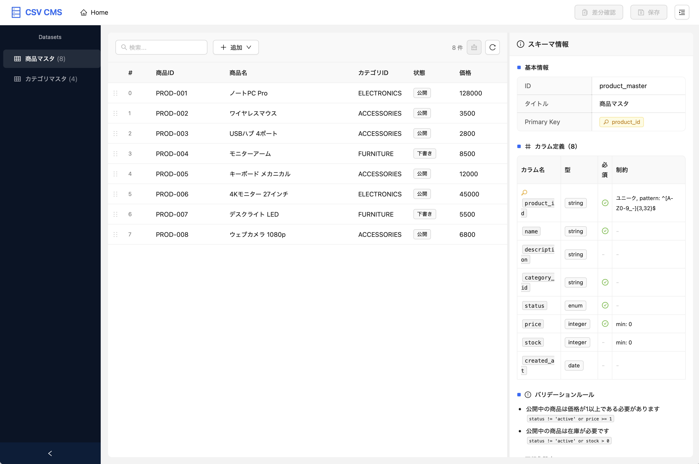
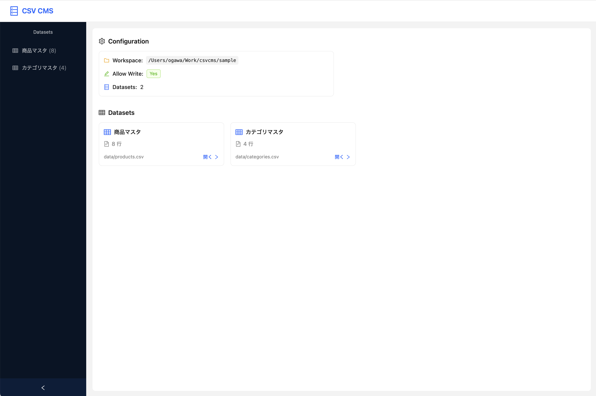
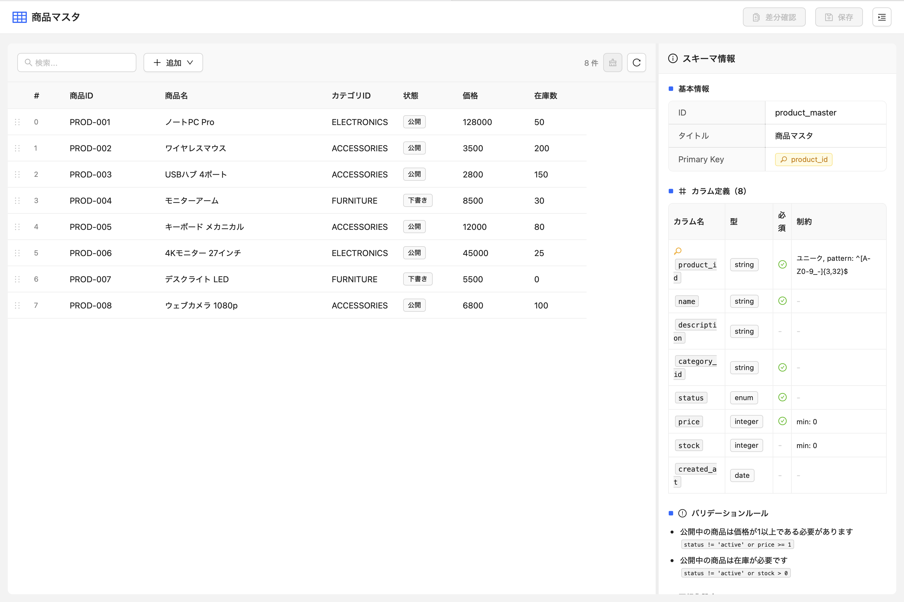

# CSV CMS

ローカルのCSVファイルを**CMS風UI（一覧 + 詳細フォーム）**で編集できるツール。

Git差分が見やすく安定するよう、保存時にCSVを正規化（列順・改行・クォート・ソート等）します。



## 特徴

- 🖥️ **CMS風UI** - 一覧表示と詳細フォームでCSVを直感的に編集
- 📋 **スキーマ定義** - YAML/JSONでフォーム・バリデーション・正規化ルールを外部定義
- 🔄 **Git差分安定** - 保存時にCSVを正規化してGit差分を最小化
- 🔒 **安全設計** - Workspace外へのアクセス禁止、パストラバーサル対策
- ⚡ **簡単起動** - `npx`一発で起動（リポジトリclone不要）

## スクリーンショット

### ホーム画面

設定ファイルのプレビューとデータセット一覧を表示します。



### データセット編集画面

テーブル/タイル表示と詳細フォームでCSVを編集できます。ドラッグ＆ドロップでの行並べ替え、キーボードナビゲーションにも対応。


### 単独モード

`--schema`オプションで設定ファイル不要の単独データセット編集が可能です。サイドバーが非表示になり、シンプルなレイアウトで表示されます。

```bash
npx csv-cms --schema schemas/product.schema.yaml --allow-write
```



## クイックスタート

### npm公開後

```bash
# 編集したいCSVがあるディレクトリで実行
npx @csvcms/cli
```

### ローカル開発

```bash
# リポジトリをクローン
git clone https://github.com/your-org/csvcms.git
cd csvcms

# 依存関係をインストール
npm install

# ビルド
npm run build

# 起動（sampleディレクトリで）
npm start -- --workspace ./sample
```

## 起動オプション

```bash
csv-cms [options]

Options:
  --config <path>      設定ファイルパス（デフォルト：CWD探索）
  --port <number>      ポート番号（デフォルト：自動採番）
  --host <host>        バインドホスト（デフォルト：127.0.0.1）
  --no-open            ブラウザを自動で開かない
  --read-only          読み取り専用モード
  --allow-write        書き込み許可
  --workspace <path>   Workspaceルートパス（デフォルト：CWD）
  --log-level <level>  ログレベル（debug|info|warn|error）
```

## 設定ファイル

プロジェクトルートに `csvcms.config.yaml` を配置：

```yaml
version: 1
workspace:
  root: "."
  allowWrite: true

datasets:
  - id: "product_master"
    title: "商品マスタ"
    csvPath: "data/products.csv"
    schemaPath: "schemas/product.schema.yaml"
```

## スキーマ定義

`schemas/product.schema.yaml` の例：

```yaml
schemaVersion: 1
id: product_master
title: 商品マスタ

csv:
  delimiter: ","
  header: true
  primaryKey: "product_id"
  normalize:
    quotePolicy: "minimal"
    newline: "lf"

columns:
  - key: product_id
    label: 商品ID
    type: string
    required: true
    unique: true
    ui: { widget: text, readonlyOnEdit: true }

  - key: name
    label: 商品名
    type: string
    required: true
    ui: { widget: text }

  - key: price
    label: 価格
    type: integer
    required: true
    min: 0
    ui: { widget: number }

ui:
  list:
    columns:
      - { key: product_id, width: 160 }
      - { key: name, width: 280 }
      - { key: price, width: 120, align: right }
```

> 📖 **詳細な設定仕様は [docs/CONFIGURATION.md](docs/CONFIGURATION.md) を参照してください。**  
> データ型、バリデーション、UIウィジェット、行ルール式など全ての設定項目を網羅しています。

## 開発

```bash
# 開発サーバー起動（API + フロントエンド）
npm run dev:all

# または個別に起動
npm run dev          # APIサーバーのみ
npm run dev:frontend # フロントエンドのみ（Vite）

# ビルド
npm run build

# テスト
npm test

# リント
npm run lint
```

## ディレクトリ構成

```
csvcms/
├── frontend/          # React SPA
│   ├── src/
│   └── vite.config.ts
├── server/            # Node.js APIサーバー
│   ├── src/
│   └── dist/
│       └── frontend/  # ビルド済みフロントエンド
├── sample/            # サンプル設定・データ
│   ├── csvcms.config.yaml
│   ├── data/
│   └── schemas/
└── docs/              # ドキュメント
```

## ドキュメント

| ドキュメント | 説明 |
|-------------|------|
| [docs/CONFIGURATION.md](docs/CONFIGURATION.md) | **設定ファイル・スキーマの詳細仕様** - 全ての設定項目を網羅 |
| [docs/README.md](docs/README.md) | 要求仕様・設計ドキュメント |
| [docs/API.md](docs/API.md) | REST API仕様 |
| [docs/FRONTEND.md](docs/FRONTEND.md) | フロントエンド実装仕様 |

## ライセンス

MIT
