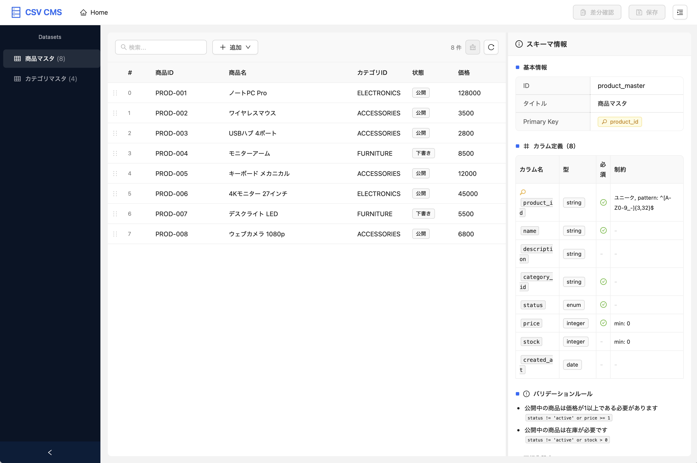
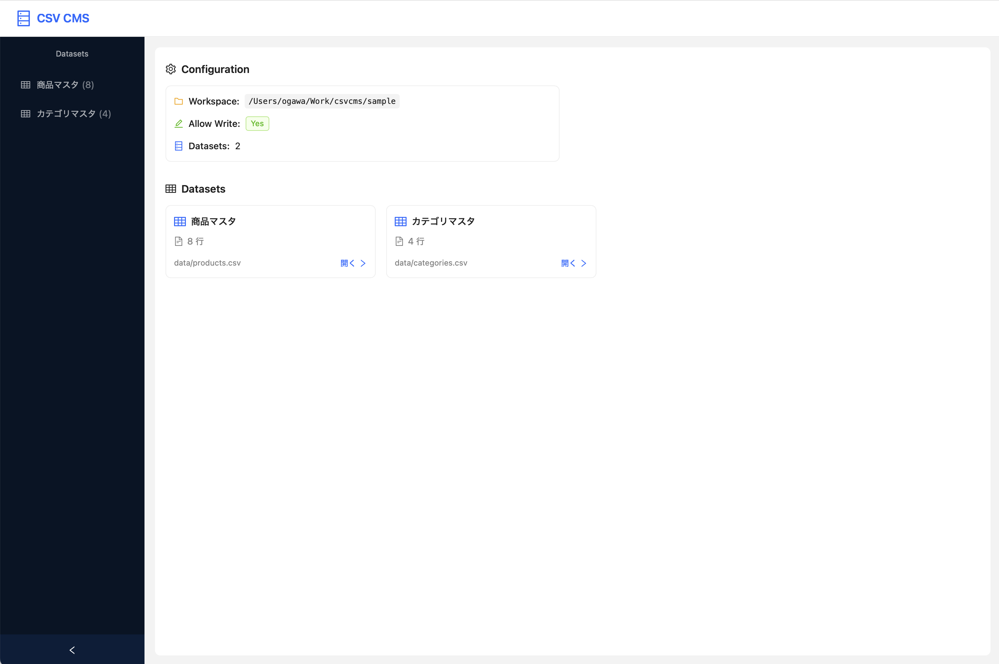
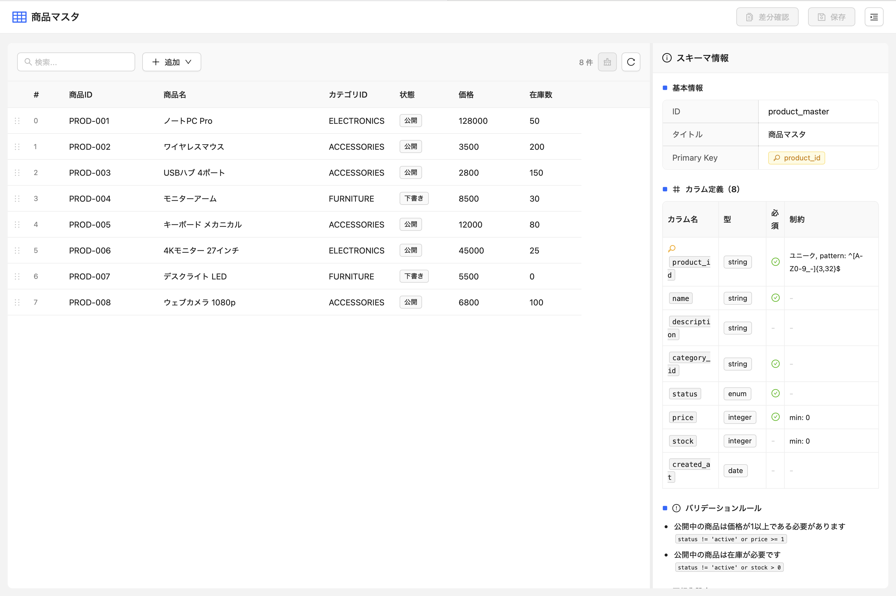

# CSVMS

Edit local CSV files with a **CMS-like UI** (list view + detail form).

CSV files are normalized on save (column order, newlines, quoting, sorting) to ensure clean and stable Git diffs.



## Features

- 🖥️ **CMS-like UI** - Edit CSV files with intuitive list and detail form views
- 📋 **Schema Definition** - Define forms, validation, and normalization rules in YAML/JSON
- 🔄 **Stable Git Diffs** - CSV normalization minimizes unnecessary changes
- 🔒 **Security** - Workspace boundary enforcement, path traversal protection
- ⚡ **Easy Start** - Single `npx` command (no clone required)

## Quick Start

```bash
# Run in the directory containing your CSV files
npx csvms
```

That's it! A browser will open with the CMS-like UI.

## Screenshots

### Home Screen



### Dataset Editor

Table/tile view with detail form. Supports drag-and-drop reordering and keyboard navigation.


### Single Dataset Mode

Use `--schema` option for editing a single dataset without a config file.

```bash
npx csvms --schema schemas/product.schema.yaml --allow-write
```



## CLI Options

```bash
csvms [options]

Options:
  --config <path>      Config file path (default: search in CWD)
  --port <number>      Port number (default: auto)
  --host <host>        Bind host (default: 127.0.0.1)
  --no-open            Don't open browser automatically
  --read-only          Read-only mode
  --allow-write        Allow write operations
  --workspace <path>   Workspace root path (default: CWD)
  --log-level <level>  Log level (debug|info|warn|error)
  --schema <path>      Single dataset mode with schema file
```

## Configuration

Create `csvms.config.yaml` in your project root:

```yaml
version: 1
workspace:
  root: "."
  allowWrite: true

datasets:
  - id: "product_master"
    title: "Product Master"
    csvPath: "data/products.csv"
    schemaPath: "schemas/product.schema.yaml"
```

## Schema Definition

Example `schemas/product.schema.yaml`:

```yaml
schemaVersion: 1
id: product_master
title: Product Master

csv:
  delimiter: ","
  header: true
  primaryKey: "product_id"
  normalize:
    quotePolicy: "minimal"
    newline: "lf"

columns:
  - key: product_id
    label: Product ID
    type: string
    required: true
    unique: true
    ui: { widget: text, readonlyOnEdit: true }

  - key: name
    label: Product Name
    type: string
    required: true
    ui: { widget: text }

  - key: price
    label: Price
    type: integer
    required: true
    min: 0
    ui: { widget: number }

ui:
  list:
    columns:
      - { key: product_id, width: 160 }
      - { key: name, width: 280 }
      - { key: price, width: 120, align: right }
```

## Documentation

- [Configuration Guide](https://github.com/foo-ogawa/csvms/blob/main/docs/CONFIGURATION.md) - Full schema and config reference
- [API Reference](https://github.com/foo-ogawa/csvms/blob/main/docs/API.md) - REST API documentation

## Requirements

- Node.js >= 20.0.0

## License

MIT


